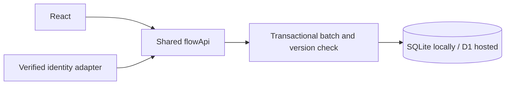

# Flowboard — Project Manager

Coordinate projects and tasks without silently overwriting another participant’s changes.

[Browser-only demo](https://memorim.github.io/flowboard-project-manager/) · [Hosted sandbox](https://memorim-flowboard-live.amusedcorgi34.chatgpt.site)

The browser-only build stores data locally. The hosted sandbox is a separate revision/deployment; new local audit guarantees are described below.


[Short interaction recording](docs/demo.gif)

## Implemented

- Kanban, task editor, filters, calendar and progress calculated from tasks.
- Private workspaces, owner/editor/viewer roles, expiring one-use invitations and owner export.
- Version-checked updates, a recycle bin, restoration, task history and activity records.

## Stack and architecture

React, TypeScript and Vite; Express, Zod and built-in Node SQLite.



## Technical mechanisms and security

- `src/flow-api.ts` is the business/API implementation shared with the local SQLite adapter. `batch` is transactional; task updates use `WHERE id=? AND version=?`. A stale write returns HTTP 409, and the UI retains the draft.
- `server/access-constraints.sql` checks current membership inside task mutations, validates assignees and requires current ownership when creating invitations. An editor revoked after request validation cannot commit a late write.
- Membership/project changes use SQL conditions that recheck current privileges. Task changes, history triggers and activity are committed together; failures roll the batch back.
- Invitation tokens contain 32 random bytes; only hashes are stored. Conditional acceptance grants one membership, and a consumed/expired invitation returns 410.
- The public workspace deliberately enrols visitors as editors. Other workspaces require explicit membership; task, history and export queries are scoped to the selected workspace.

## Local setup

Node.js 24.18.0 and pnpm 11.7.0 (see version files).

```bash
npm install --global pnpm@11.7.0
pnpm install --frozen-lockfile
pnpm build
pnpm start
```

Open `http://localhost:4100`. For live UI development use `pnpm dev` where available. The API binds to `127.0.0.1` by default.

## Configuration

Configure process environment variables using [.env.example](.env.example). `pnpm start` uses the process environment; it does not implicitly load that file. To load a copied `.env` explicitly, run `node --env-file=.env --import tsx server/index.ts`.

## Database and upgrades

SQLite is stored at `data/flowboard.db`. Initialization creates/migrates the schema; sample rows are included for local use. Back up the database before upgrades. Do not remove the database as a migration step.

## Verification

```bash
pnpm test
pnpm test:contract
pnpm test:upgrade
pnpm typecheck
pnpm build
pnpm exec playwright install chromium firefox webkit
pnpm test:e2e
pnpm audit --audit-level=high
```

`tests/audit.test.ts`: revocation between validation and commit, and competing invitation acceptance. Existing API/E2E tests cover viewer restrictions, workspace isolation, stale versions, draft preservation, restoration and backup recovery.

CI installs locked dependencies and runs the configured checks; documentation checks also validate local links/images. Python dependency auditing uses `pip-audit --disable-pip --no-deps --strict -r requirements-lock.txt`. A passing scanner only reports known advisories at the time of the run.

## Limits and next steps

- The local Node adapter trusts the `X-Demo-Actor` development header; it is not public authentication. It binds to loopback by default. Do not expose it as a multi-user service without a verified identity adapter.
- The native hosted version uses ChatGPT identity and D1. Its currently deployed revision is separate; repository security fixes are not a claim that a new Site version has been deployed.
- The public sandbox is intentionally collaborative. Request limits and workspace quotas are small per-demo controls, not distributed admission control.
- SQLite is a single-writer store. No email invitation delivery, billing or organization directory integration is implemented.

## Further documentation

[Audit findings and follow-up](docs/AUDIT_2026_10.md) · [Technical reference](docs/TECHNICAL.md) · [Change history](CHANGELOG.md)

[API request/response example](docs/API_EXAMPLE.md)

[Scheduled backups and recovery](docs/SCHEDULED_BACKUPS.md) · [Hosted adapter](hosting/README.md)
