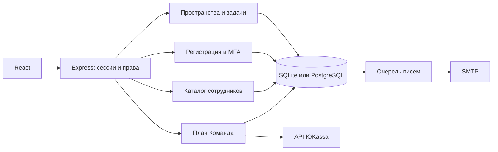

# Flowboard - проекты и задачи команды

Канбан с приватными рабочими пространствами, ролями, историей изменений и защитой от потери данных при одновременном редактировании.

[Открыть проект в браузере](https://memorim.github.io/flowboard-project-manager/) · [Серверная версия](https://memorim-flowboard.onrender.com/)


## Что работает

- Задачи, проекты, поиск, фильтры, календарь, корзина и восстановление; показатели рассчитываются по задачам.
- Приватные пространства и роли владельца, редактора и наблюдателя. Приглашения ссылкой или письмом с проверкой адреса получателя.
- Вход через Google, Яндекс, GitHub и Telegram после подключения приложений провайдеров; привязка к существующему аккаунту с подтверждением.
- Регистрация с подтверждением почты, восстановление пароля, TOTP с QR-кодом и одноразовыми резервными кодами, список и отзыв сессий.
- SCIM 2.0: пользователи, группы, активация и отзыв доступа в пределах одного пространства. Токен создаёт владелец после проверки пароля.
- ЮKassa: разовая оплата плана «Команда» на 30 дней, квота проектов ×4, без автопродления. Цена задаётся сервером; статус подтверждается запросом к API магазина.
- SQLite для одного сервера или PostgreSQL для нескольких экземпляров; общие счётчики запросов, транзакции, проверки миграций и перенос данных.

Настройка методов входа и проверяемые гарантии описаны в [OAuth/OIDC](docs/SOCIAL_LOGIN.md). На размещённом сервере доступны только подключённые методы; SMTP и ключи провайдеров настраиваются отдельно.

## Быстрый запуск полного приложения

Нужны Docker Compose, Node.js 24.18.0 и pnpm 11.7.0.

```bash
pnpm install --frozen-lockfile
pnpm setup:local
docker compose up --build -d
```

Откройте `http://127.0.0.1:4100`, зарегистрируйтесь и подтвердите почту через локальный почтовый ящик `http://127.0.0.1:8025`. Затем создайте своё пространство. SMTP Mailpit принимает письма локально; внешним адресатам они не уходят. PostgreSQL хранится в именованном томе. `docker compose down` останавливает приложение и сохраняет данные; не добавляйте `-v`, если они нужны.

`setup:local` создаёт новые случайные секреты в игнорируемом `.env` и отказывается заменять существующий файл. Этот Compose предназначен для локального запуска: порты опубликованы только на loopback. Для публичного сервера используйте [инструкцию размещения](docs/DEPLOYMENT.md).

### Без Docker, с существующей SQLite

```bash
pnpm install --frozen-lockfile
pnpm build
pnpm start
```

Сервер слушает `127.0.0.1:4100`, база остаётся в `data/flowboard.db`. Без SMTP/key можно войти в ранее созданный аккаунт или воспользоваться `pnpm account:create` по [инструкции](docs/SESSION_AUTH.md). Для регистрации, писем и MFA заполните [.env.example](.env.example) и загрузите настройки явно:

```bash
node --env-file=.env --import tsx server/index.ts
```

`pnpm dev` запускает API и Vite; при другом origin настройте его явно. Загрузка `.env` автоматически не выполняется.

## Архитектура

React 19, TypeScript, Vite, Express 5 и Zod. PostgreSQL использует `pg`, SQLite - встроенный `node:sqlite`; SMTP - Nodemailer. TOTP использует криптографию Node.js, QR формируется на сервере. Платёжные запросы выполняются к фиксированному API ЮKassa.



### Корректность и безопасность

- CAS-обновления `WHERE id=? AND version=?`: конкурентный проигравший получает 409, его черновик сохраняется. Изменение, история и активность фиксируются одной транзакцией.
- SQL-триггеры повторно проверяют членство и назначение исполнителя. PostgreSQL блокирует связанные строки; операции Node/SQLite сериализуются внутри адаптера, включая асинхронные транзакции.
- Сессии - случайные непрозрачные cookie, в БД только хеш; HttpOnly, SameSite=Strict, Secure при HTTPS. Заголовок выбора участника не авторизует серверные запросы.
- Пароли - salted scrypt; проверка Origin, ограниченные JSON-тела, ограничение KDF и атомарные счётчики в общей БД. PostgreSQL позволяет разделять бюджет запросов между экземплярами сервера.
- Сброс пароля одноразовый и отзывает сессии; MFA при сбросе остаётся включённой. TOTP защищён от повторного использования, резервные коды хешируются. Секрет MFA и очередь писем зашифрованы AES-256-GCM ключом оператора.
- Одноразовые ссылки приглашений хранятся как хеши. Письмо и бизнес-изменение добавляются транзакционно. Очередь использует lease, ограниченные повторы и стабильный Message-ID; повторная доставка после сбоя между SMTP-ответом и фиксацией возможна.
- Платёжная сумма хранится целыми копейками. Повтор использует тот же ключ ЮKassa; callback служит сигналом для проверки через API. Период плана применяется один раз в транзакции. Фоновая сверка восстанавливает неопределённые результаты.

## Данные, миграции и резервные копии

SQLite обновляется добавлением схемы с сохранением прежних данных. PostgreSQL миграции применяются под advisory lock и проверяют контрольные суммы. Перед обновлением сохраните резервную копию. Не удаляйте БД вместо обновления.

Для переноса подготовьте актуальную офлайн-копию SQLite и **пустую** PostgreSQL:

```bash
# DATABASE_URL должен указывать на новую PostgreSQL, приложение остановлено.
pnpm db:import-sqlite path/to/offline-backup.db
```

Импорт читает источник без записи, выполняет одну транзакцию, сверяет содержимое каждой таблицы и восстанавливает последовательности ID. Непустой приёмник отклоняется. Сохраните прежний `FLOW_APP_KEY`: без него существующие MFA и письма не расшифровать. [Подробности эксплуатации](docs/DEPLOYMENT.md).

## Проверки

```bash
pnpm lint
pnpm format:check
pnpm test
pnpm test:contract
pnpm test:upgrade
pnpm typecheck
pnpm build
pnpm exec playwright install chromium firefox webkit
pnpm test:e2e
pnpm test:e2e:auth
pnpm audit --audit-level=high
```

Без `FLOW_TEST_DATABASE_URL` PostgreSQL-сценарии отмечаются как пропущенные. Для их фактического выполнения задайте URL отдельной тестовой БД: проверки создают и удаляют собственные схемы. CI предоставляет PostgreSQL 16 и запускает эти сценарии. Браузерные тесты используют отдельные БД в памяти.

`account-flows.test.ts` проверяет регистрацию, сброс, MFA и сессии; `directory.test.ts` - SCIM, изоляцию и почтовые приглашения; `billing.test.ts` - оплату и повторы; `mail.test.ts` - настоящий локальный SMTP; `postgres.test.ts` - два независимых экземпляра и конкурентные операции; `import-sqlite.test.ts` - сохранность переноса. [Фактически выполненные проверки](docs/COMPLETION_VERIFICATION.md).

## Условия подключения

- GitHub Pages выполняет браузерный вариант. Полная новая серверная версия собирается одним образом вместе с интерфейсом; прежний публичный D1-адаптер не получает новые серверные интеграции автоматически.
- Для настоящих писем нужны SMTP-реквизиты, для платежей - магазин ЮKassa. По умолчанию реальные платежи запрещены; проверка внешнего магазина требует его тестовых ключей. Возвраты оформляет оператор в магазине, автопродления нет.
- SCIM реализует описанное подмножество стандарта: User/Group CRUD/PATCH, eq-фильтры, ETag и пагинацию. `userName` неизменяемый; nested groups и Bulk не поддерживаются. Совместимость с конкретным IdP проверяется при подключении.
- SQLite сохраняет ограничение одного писателя; для нескольких экземпляров используется PostgreSQL. Квоты настраиваются оператором, отключать защиту от злоупотреблений не требуется.
- Режим демо-участника остаётся строго локальным и явно включаемым. Это защитное правило, а не способ входа в публичный сервер.

## Документация

[Аккаунты и MFA](docs/SESSION_AUTH.md) · [Интеграции](docs/INTEGRATIONS.md) · [Размещение и перенос](docs/DEPLOYMENT.md) · [API-пример](docs/API_EXAMPLE.md) · [Резервные копии SQLite](docs/SCHEDULED_BACKUPS.md) · [Существующий адаптер D1](hosting/README.md) · [История изменений](CHANGELOG.md)
